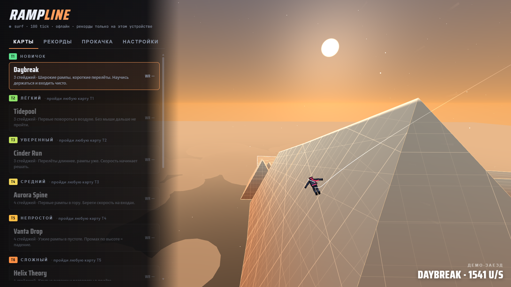
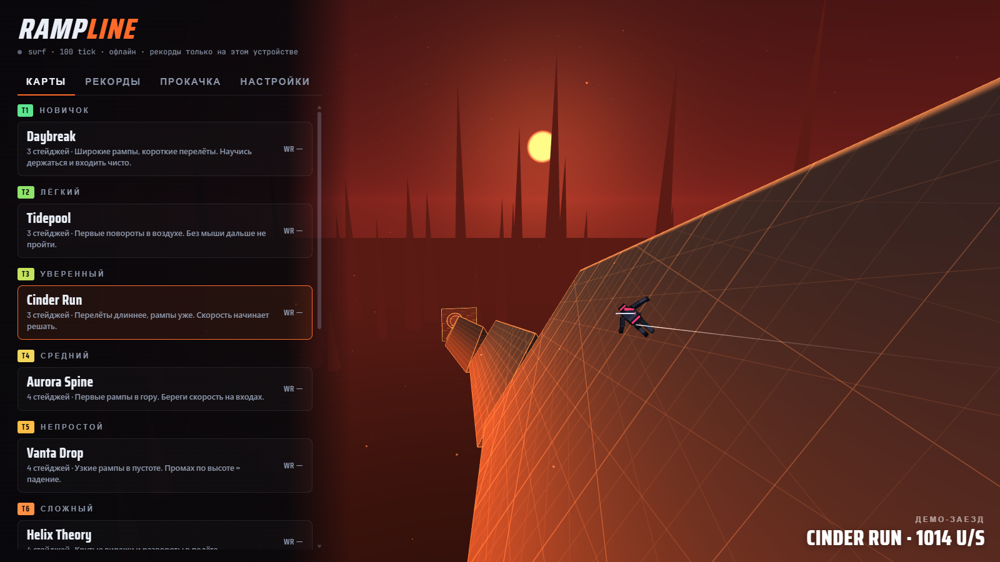
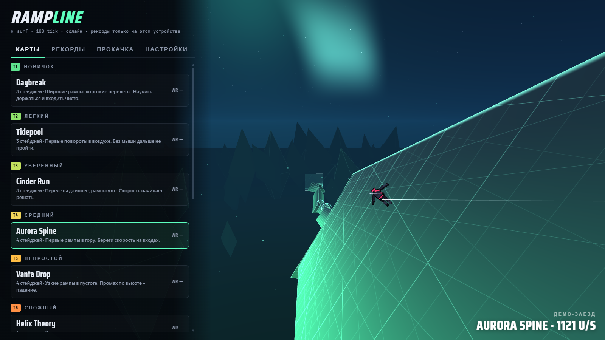
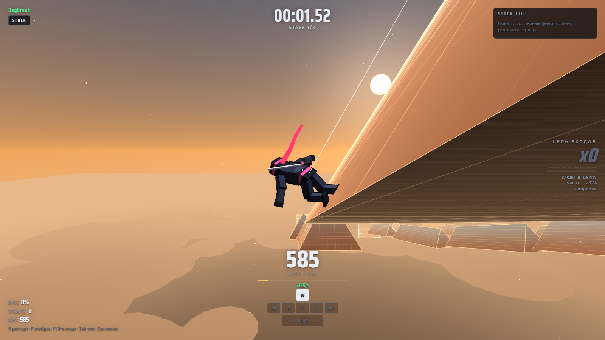

<p align="center"></p>

<h1 align="center">RAMPLINE</h1>

<p align="center">
  <b>Surf в браузере на физике в духе Source.</b><br>
  <i>Browser surf with Source-style movement.</i>
</p>

<p align="center">
  
  
  
  
  
</p>

<p align="center">
  <a href="https://x1as.github.io/rampline/"><b>▶ Играть в браузере</b></a> (клавиатура и мышь) &nbsp;·&nbsp; <a href="#english">English</a>
</p>

> **В двух словах.** Ложишься на наклонную рампу, стрейфишь в воздухе и разгоняешься до тысяч u/s, как на surf-картах из CS. Десять карт от T1 до T10 генерируются из seed, а проходимость каждой доказывает бот, который едет на той же физике, что и игрок.

## Под капотом

| | |
|---|---|
| 🧱 **Физика как в Source** | игрок это бокс 32×72×32, мир собран из выпуклых брашей; `trace`, `slideMove` с клиппингом скорости, `airAccelerate` для разгона стрейфом; фиксированный шаг 100 Гц и интерполяция кадра |
| 🤖 **Карты доказывает бот** | геометрия строится из тира и seed; каждый кусок рампы прогоняется эксперт-ботом, а если даже он не проезжает, кусок смягчается |
| 🧪 **Сложность в цифрах** | тесты в Node без браузера: эксперт проходит 10/10 карт без смертей, наивный бот не проходит первый стейдж нигде, бот с шумом во вводе проходит T1–T3 и срезается на T8–T10 |
| 👻 **Призраки** | лучший заезд пишется на 20 Гц с дельта-кодированием и едет рядом в следующей попытке |
| 🥷 **Ниндзя из кода** | модель и анимации процедурные (`ninja.js`), внешних ассетов нет |

## Галерея

<table>
  <tr>
    <td width="50%"><br><sub><b>Cinder Run, T3.</b> У каждой карты своё небо, туман, цвет рамп и декор.</sub></td>
    <td width="50%"><br><sub><b>Aurora Spine, T4.</b> За меню всегда едет бот: демо-заезд на той же физике.</sub></td>
  </tr>
  <tr>
    <td colspan="2"><br><sub><b>Заезд.</b> Таймер, стейджи, цепь чистых входов в рампу, скорость в u/s. Третье лицо на F1.</sub></td>
  </tr>
</table>

## Стек

JavaScript без фреймворков · three.js · свои шейдеры рамп и неба · Web Audio · Node.js для сборки и тестов.

## Запуск

```bash
node src/build.js     # склеивает всё в dist/index.html
```

Открой `dist/index.html` в браузере. На Windows то же делает `play.bat`. Версия на GitHub Pages лежит в ветке `gh-pages`.

```bash
cd src
node skilltest.js all 6   # эксперт, наивный и «шумный» бот на каждой карте
node bottest.js           # проходимость всех карт эксперт-ботом
node bumptest.js          # гладкость рамп и стоимость тика
node noisetest.js         # устойчивость к ошибкам ввода
```

На Windows все четыре теста запускает `test.bat`.

## Управление

WASD и мышь: в воздухе зажимай A или D и веди мышью за стрейфом. Пробел прыжок, R рестарт, F вернуться на стейдж, F1 третье лицо, Tab таблица, Esc меню.

## Структура

| Файл | Что внутри |
|---|---|
| `src/core.js` | физика, трассировка, генерация карт симуляцией, бот, комбо |
| `src/maps.js` | 10 карт: тир, seed, тема |
| `src/render.js` | рендер three.js: шейдеры рамп, небо, декор, скоростные эффекты |
| `src/ninja.js` | модель ниндзя и процедурные анимации |
| `src/game.js` | ввод, игровой цикл, HUD, меню, звук, рекорды |
| `src/page.html` | разметка и стили |
| `src/build.js` | сборка в одну страницу |
| `src/*test.js` | тесты физики и карт на ботах |

---

<a id="english"></a>
## English

**RAMPLINE** is browser surf with Source-style movement: a 32×72×32 hull traced against convex brushes, velocity clipping, air-strafe acceleration and a fixed 100 Hz tick. Ten maps from T1 to T10 are generated from a tier and a seed and proven by an expert bot that rides the same physics as the player. Node tests show the expert clearing all 10 maps while a naive bot fails the first stage everywhere. Vanilla JavaScript and three.js in a single 150 KB page.

▶ **[Play in the browser](https://x1as.github.io/rampline/)** (keyboard and mouse)

---

<p align="center"><sub>Сделано <a href="https://github.com/x1as">@x1as</a> · 2026 · <a href="https://x1as.github.io/">портфолио</a></sub></p>
